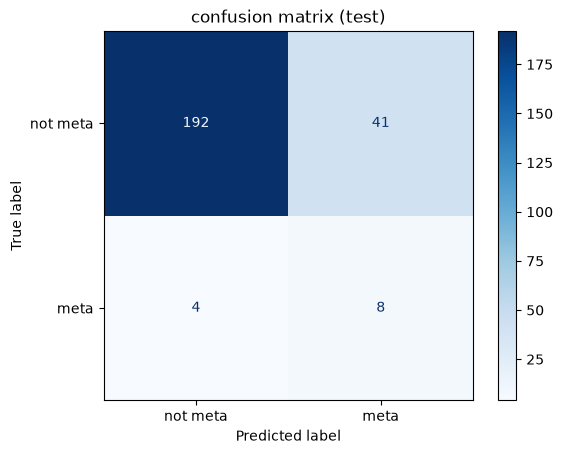
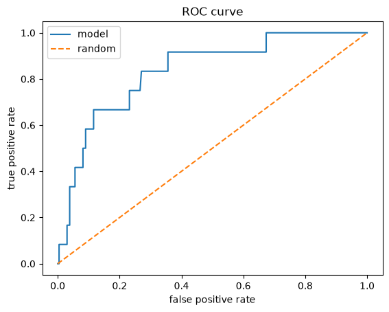
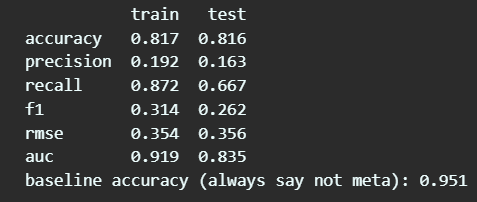

# ⚡ The VGC Meta-Gatekeeper

Predicts whether a Pokémon is "meta" (≥ 1% usage at the VGC World Championships 2024) from its base stats, types and abilities, using logistic regression (pandas, numpy, matplotlib, seaborn, scikit-learn).

  

**Course:** AI101: Data Science and AI Essentials with Python, School of AI & Data Engineering, IIT Ropar

---

## Table of contents

1. [Team and roles](#1-team-and-roles)
2. [Problem and dataset](#2-problem-and-dataset)
3. [Project structure](#3-project-structure)
4. [Setup](#4-setup)
5. [Steps to run](#5-steps-to-run)
6. [Expected output](#6-expected-output)
7. [Method (what the code does)](#7-method-what-the-code-does)
8. [Results and interpretation](#8-results-and-interpretation)
9. [Limitations](#9-limitations)
10. [Links: slides and video](#10-links-slides-and-video)
11. [AI-use disclosure](#11-ai-use-disclosure)
12. [Troubleshooting](#12-troubleshooting)

---

## 1. Team and roles

**Team number:** 30

| Member | Entry no. | GitHub handle | Role (deliverable) | Code section written |
|---|---|---|---|---|
| N Shasank Kumar Reddy | 2026DAB1297 | [@2026dab1297-dotcom](https://github.com/2026dab1297-dotcom) | Documentation lead (README, project structure, docs) | Part 1: loading data, target creation, EDA |
| Malla Dharani Chand | 2026MCB1541 | [@DharaniMC](https://github.com/DharaniMC) | Execution lead (requirements.txt, exact run commands, fresh-clone test) | Part 3: training functions, tuning, training plots |
| Kanishk | 2026AIB1047 | [@Kanishk34](https://github.com/Kanishk34) | PPT lead (exactly 5 slides) | Part 2: preprocessing, split, scaling, feature selection |
| Palagiri Bhavesh | 2026EEB1387 | [@2026eeb1387](https://github.com/2026eeb1387) | Video lead (max 5 minutes) | Part 4: evaluation, coefficients, interpretation |

All four members wrote code and committed from their own GitHub accounts (see the [commit history](https://github.com/2026dab1297-dotcom/vgc-meta-predictor/commits/main)).

---

## 2. Problem and dataset

**Question:** Can a Pokémon's base stats, typing and abilities predict whether it appears at the VGC World Championships?

**Why it matters:** Competitive Pokémon (VGC) has over 1,000 Pokémon but only a small group is actually used at top level (the "meta"). A model that flags likely meta Pokémon shows how much of the meta is explained by raw stats and typing alone.

**Dataset:** [Pokémon Competitive Usage (Smogon and VGC Worlds)](https://www.kaggle.com/datasets/danielsmdev/pokemon-competitive-usage-smogon-and-vcgworlds) from Kaggle. The CSV is already included in this repo at `dataset/pokemon_competitive_analysis.csv`, so no download is needed.

| Item | Value |
|---|---|
| Raw size | 1303 rows × 23 columns |
| After removing `-mega` and `-gmax` forms (not used in VGC) | 1221 rows |
| Columns | index, name, type1, type2, ability1, ability2, hidden_ability, hp, attack, defense, sp_atk, sp_def, speed, total_stats, legendary, mythical, generation, Smogon_VGC_Usage_2022/2023/2024, Worlds_VGC_Usage_2022/2023/2024 |
| Target (`mt`) | 1 (meta) if `Worlds_VGC_Usage_2024` ≥ 1.0%, else 0 |
| Class balance | 59 meta vs 1162 not meta (about 4.8% meta, heavily imbalanced) |
| Missing values | The usage columns contain the text "NoUsage"; the code converts it to 0. No missing values remain in the final feature matrix. |

---

## 3. Project structure

```
vgc-meta-predictor/
├── README.md                              # this file
├── requirements.txt                       # pinned library versions
├── dataset/
│   └── pokemon_competitive_analysis.csv   # 1303 rows, 23 columns (raw data)
├── code/
│   └── main.ipynb                         # the full project code (Parts 1 to 4)
├── outputs/                               # screenshots of expected results
│   ├── confusion_matrix.png
│   ├── roc_curve.png
│   └── metrics_table.png
└── docs/
    ├── vgcmeta.pdf                        # exactly 5 slides
    └── (video link is given in Section 10)
```

> The notebook reads the data with the relative path `../dataset/pokemon_competitive_analysis.csv`, so `code/` and `dataset/` must sit side by side exactly as shown above. No absolute paths (such as `C:/Users/...`) are used anywhere.

---

## 4. Setup

**Tested on:** Python 3.11, Windows.
**Requires:** Python 3.11 or newer (the pinned library versions need it).

**Libraries** (pinned in `requirements.txt`):

| Library | Version | Used for |
|---|---|---|
| numpy | 2.4.6 | numeric arrays |
| pandas | 3.0.6 | loading and cleaning data |
| matplotlib | 3.11.2 | plots |
| seaborn | 0.13.2 | heatmap and boxplot |
| scikit-learn | 1.9.1 | scaling, feature selection, logistic regression, metrics |
| notebook | 7.6.5 | to open and run the `.ipynb` file |

**Prerequisites:** Python 3.11 or newer, and Git installed. Check with:

```bash
python --version
git --version
```

(On macOS/Linux, use `python3` if `python` is not found.)

---

## 5. Steps to run

Run these commands **in order** in a terminal (Command Prompt / PowerShell on Windows, Terminal on macOS/Ubuntu).

### Step 1: Clone the repository

```bash
git clone https://github.com/2026dab1297-dotcom/vgc-meta-predictor.git
cd vgc-meta-predictor
```

> **No Git installed?** On the GitHub page click **Code → Download ZIP**, right-click the ZIP and choose **Extract All**, then open a terminal inside the extracted folder (the one that contains `code`, `dataset` and `requirements.txt`) and continue from Step 2. The folder will be named `vgc-meta-predictor-main`.

### Step 2: Create a virtual environment

```bash
python -m venv venv
```

### Step 3: Activate it

| System | Command |
|---|---|
| Windows (Command Prompt) | `venv\Scripts\activate` |
| Windows (PowerShell) | `venv\Scripts\Activate.ps1` |
| macOS / Ubuntu | `source venv/bin/activate` |

You should now see `(venv)` at the start of your terminal line.

### Step 4: Install the libraries

```bash
pip install -r requirements.txt
```

### Step 5: Start Jupyter and open the notebook

```bash
jupyter notebook
```

In the browser window that opens, go into the `code` folder and click `main.ipynb`.

> The notebook must be opened from inside the repo so that the relative path `../dataset/...` resolves correctly.

### Step 6: Run everything

In the notebook menu click **Kernel → Restart Kernel and Run All Cells**.
**If you use VS Code instead of the browser:**

1. Open the repo folder (File → Open Folder) and open `code/main.ipynb`.
2. Click **Select Kernel** (top right) → **Python Environments** → choose the one inside `venv` (`venv\Scripts\python.exe` on Windows).
3. If VS Code says *"Running cells with 'Python 3.x' requires the ipykernel package"*, do **not** click Install. Click **Change Kernel** and pick the `venv` one instead (ipykernel is already installed in `venv` together with `notebook`).
4. Click **Run All**.

### Step 7: Check the output

Compare your output with Section 6. Everything runs top to bottom with no manual edits. The random seeds are fixed (`random_state=42`), so the numbers should match.

**Expected runtime:** about 20 to 30 seconds on our laptop (no GPU needed).

---

## 6. Expected output

When the notebook finishes, you should see the following key results.

**Key lines printed by the notebook (simplified)**

```
Shape (rows, columns): (1303, 23)
after removing forms: (1221, 23)
mt: 0 -> 1162, 1 -> 59
train: (976, 133)  test: (245, 133)
25 features selected
best C: 10
```

**Final metrics (logistic regression with `class_weight="balanced"`, C = 10, threshold 0.5)**

| Metric | Train | Test |
|---|---|---|
| Accuracy | 0.817 | 0.816 |
| Precision | 0.192 | 0.163 |
| Recall | 0.872 | 0.667 |
| F1 | 0.314 | 0.262 |
| RMSE | 0.354 | 0.356 |
| AUC | 0.919 | 0.835 |

Baseline accuracy (always predict "not meta") = **0.951**.

**Confusion matrix on the test set:** TN = 192, FP = 41, FN = 4, TP = 8.

**Screenshots**

| Confusion matrix | ROC curve | Metrics table |
|---|---|---|
|  |  |  |

**Example predictions from `check("name")`**

| Pokémon | P(meta) | Predicted | Actual | In |
|---|---|---|---|---|
| Charizard | 0.91 | META | META | train |
| Tyranitar | 0.88 | META | META | train |
| Gholdengo | 0.80 | META | META | test |
| Hydreigon | 0.89 | META | META | test |
| Eldegoss | 0.04 | NOT META | NOT META | test |
| Rillaboom | 0.27 | NOT META | META (missed) | train |
| Corviknight | 0.39 | NOT META | META (missed) | test |

---

## 7. Method (what the code does)

Pipeline: **data → clean → target → features → split → scale → select → train → evaluate**

1. **Load and clean:** read the CSV, drop mega and gmax forms, convert "NoUsage" to 0 in all usage columns.
2. **Target:** `mt = 1` if `Worlds_VGC_Usage_2024 ≥ 1.0`.
3. **EDA:** mean/median/std, covariance, correlation heatmap, and a speed-by-usage-tier boxplot (tiers: T1 ≥ 15%, T2 ≥ 5%, T3 ≥ 1%, T4 below 1%).
4. **Features:** 6 base stats, `legendary`, `mythical`, one-hot types (`t_*`) and one-hot abilities (`a_*`, only abilities shared by at least 10 Pokémon). `total` is not used because it is just the sum of the 6 stats. Final matrix: 1221 × 133.
5. **Split:** 80/20 stratified train/test split (`random_state=42`).
6. **Scaling:** `StandardScaler` fitted **only on the training set** to avoid data leakage.
7. **Feature selection:** `SelectKBest(f_classif, k=25)`, with the 6 base stats always kept.
8. **Training:** `LogisticRegression` with and without `class_weight="balanced"`. C is chosen from `[0.001, 0.01, 0.1, 1, 10]` using 5-fold stratified cross-validation on F1 (best C = 10).
9. **Plots:** F1 vs C, learning curve (log loss vs training size), sigmoid curves for `speed` and `total`.
10. **Evaluation:** accuracy, precision, recall, F1, RMSE, AUC, confusion matrix, ROC curve, threshold sweep (0.3 to 0.7), coefficient plots, and the `check("name")` helper to test any Pokémon.

---

## 8. Results and interpretation

- **Why accuracy is misleading:** the plain model reaches 94.3% accuracy but 0.0 recall, because it just predicts "not meta" for everything. The balanced model has lower accuracy (81.6%) but finds **67% of the real meta Pokémon** (8 of 12 in the test set). This is why we report recall, F1 and AUC.
- **AUC = 0.835** on the test set, so the model ranks meta Pokémon well above non-meta ones, much better than random (0.5).
- **Precision is low (0.163):** only about 16% of the Pokémon the model calls "meta" are truly meta. Raising the threshold to 0.7 improves precision (0.241) and F1 (0.341) but lowers recall (0.583).
- **Most helpful features:** `sp_atk`, `defense`, `hp`, `attack`, `a_friend-guard`. **Most harmful:** `legendary`, `t_bug`, `a_run-away`, `t_no_type`, `t_dragon`. Legendaries are mostly banned or restricted in the format, so being legendary lowers the chance of being meta.
- **Train vs test gap** (AUC 0.919 vs 0.835) shows mild overfitting, which is expected with only 59 positive examples.

---

## 9. Limitations

- The dataset has **no moves, items or team roles**. Pokémon that are meta because of their moves are missed, for example Rillaboom (29.72% usage, P(meta) = 0.27, thanks to Fake Out and Grassy Glide) and Corviknight (Tailwind support).
- Only **59 meta Pokémon** exist in total (12 in the test set), so metrics can change noticeably with a different split.
- The target uses a single year (Worlds 2024) and a 1% cut-off, which is a design choice.
- Base stats alone cannot fully decide the meta.

---

## 10. Links: slides and video

- **Slides (exactly 5):** [`vgcmeta.pdf`](vgcmeta.pdf)
- **Video (max 5:00):** VIDEO_LINK_PENDING (unlisted YouTube or Drive link, "anyone with the link can view")

---

## 11. AI-use disclosure

- **Gemini:** used for clearing doubts and concepts while learning.
- **Claude (Anthropic):** used for code clarification (understanding what the code does) and as a reference for drafting this README, which the team then edited.
- **ChatGPT (OpenAI):** used to cross-check our work.
- We checked AI output by running the notebook ourselves, comparing results with what we expected, and reviewing the code as a team. All code is understood by the team and explained in the video.
- No AI was used to generate the dataset or the results; all numbers come from running the notebook on the Kaggle dataset.

---

## 12. Troubleshooting

| Problem | Fix |
|---|---|
| `FileNotFoundError: CSV not found` | You opened the notebook from the wrong place. Keep the folders `code/` and `dataset/` side by side and start Jupyter from the repo root. |
| `ModuleNotFoundError` | The virtual environment is not active, or step 4 was skipped. Activate `venv` and run `pip install -r requirements.txt` again. |
| `DLL load failed ... An Application Control policy has blocked this file` | Windows security (Smart App Control / AppLocker) is blocking the compiled libraries on that computer. It is not a project error. Run the project on a computer without this restriction, or ask the administrator to allow Python packages. |
| PowerShell blocks `Activate.ps1` | Use Command Prompt instead, or run `Set-ExecutionPolicy -Scope Process RemoteSigned` and try again. |
| `jupyter` is not recognised | Make sure `venv` is active and the notebook package installed correctly (re-run step 4). |
| Numbers differ slightly | Make sure you are using the pinned versions from `requirements.txt` and ran **Restart Kernel and Run All Cells**. |
